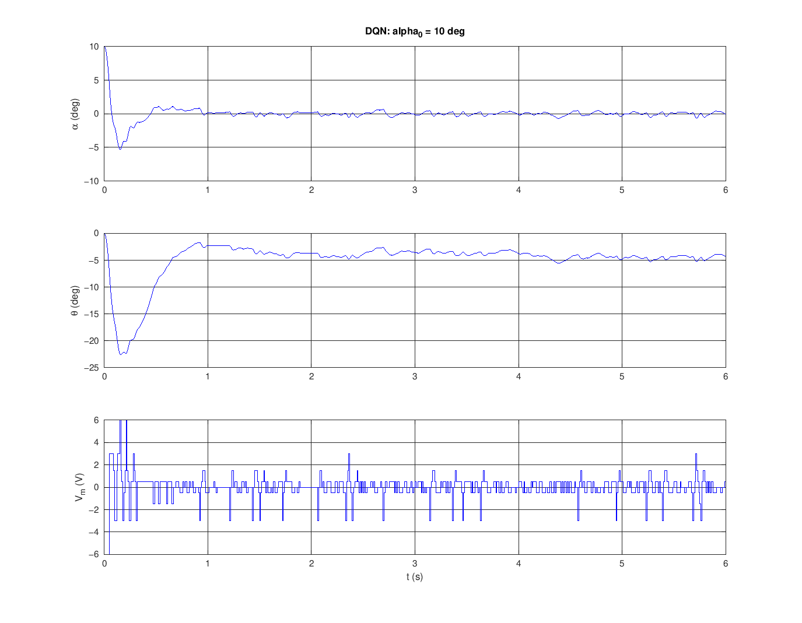

# Control inverso con red neuronal DQN – péndulo invertido Quanser Qube-Servo 3

Una red neuronal entrenada con **Deep Q-Learning (DQN)** en **Python**, sobre el
**modelo no lineal** del Qube-Servo 3, se usa como controlador directo del
péndulo. Es el **control inverso**: la red recibe el estado medido
`X = [θ, α, θ̇, α̇]` y entrega directamente el voltaje del motor `u`.
**Ya no se usa LQR.**

```
                 ┌────────────────────────── Qube (real o simulado) ─────────────────────────┐
u (V) ─────────► │ motor + brazo + péndulo → encoders (2048 cuentas/rev) → observadores (State X) │ ──► X
  ▲              └────────────────────────────────────────────────────────────────────────────┘     │
  │                                                                                                  │
  └── Enable Balance Control Switch (|α| ≤ 15°) ◄── Rate Transition ◄── Controlador DQN ◄── ZOH (10 ms) ◄┘
```

## Contenido

```
python/                          ENTRENAMIENTO (opcional: la red ya viene entrenada)
  qube_model.py                  modelo no lineal (verificado contra tus matrices A, B)
  rl_env.py                      entorno RL: planta + encoders + TUS observadores + ruido
  train_dqn.py                   entrena el DQN y exporta models/dqn_qube.mat
matlab/
  prueba_dqn_modelo_no_lineal.m  PASO A1: prueba en script (sin Simulink ni QUARC)
  construir_entorno_pruebas.m    PASO A2: Simulink de pruebas con Qube simulado (sin QUARC)
  conectar_al_simulink_original.m PASO B: pone la red en tu modelo de Quanser
  dqn_controller_block.m         código del bloque "Controlador DQN"
  cargar_red_dqn.m               carga red_dqn, Ts_agente y L, beta, m (lo llama la InitFcn)
  variables_entorno_pruebas.m, planta_qube_block.m, qube_params.m,
  qube_nonlinear_dynamics.m, simular_lazo_cerrado.m, politica_dqn.m, tasa_exito.m
  ProyectoControlFinal.m         tu script original
simulink/
  qs3_lqr_ctrl_simulinkFInal.slx tu modelo original de Quanser (no se modifica)
models/
  dqn_qube.mat                   red entrenada (pesos, acciones, Ts_agente)
  dqn_qube.pt, dqn_qube.json     checkpoint de PyTorch y configuración
```

## Resultados (modelo no lineal)

Prueba con parámetros físicos variados ±15 %, encoders cuantizados, tus
observadores de velocidad y ruido. Éxito = el péndulo no cae y termina con
|α| < 3° y |θ| < 15°.

| Prueba | Resultado |
|---|---|
| Bloque de Simulink vs PyTorch (200 estados) | 0 acciones distintas |
| Validación en Python durante el entrenamiento | 98.8 % |
| Monte Carlo MATLAB (N = 500) | **99.6 %** |
| α₀ = 10° | se estabiliza en < 1 s; el brazo queda a ~4° del centro |
| Golpe al péndulo (2.5 rad/s) | α máx 6.5°, recupera en < 1 s |



---

# Guía paso a paso

## Requisitos

| Para… | Necesitas |
|---|---|
| Parte A (pruebas, **sin licencia de Quanser**) | MATLAB + Simulink (A1 funciona incluso sin Simulink, o en GNU Octave) |
| Parte B (Qube real) | MATLAB + Simulink + **QUARC** + Qube-Servo 3 conectado por USB |
| Reentrenar (opcional) | Python 3.10+ |

No se necesitan Control System Toolbox ni Symbolic Math Toolbox:
`cargar_red_dqn` calcula las ganancias de tus observadores (a = 100).

## Paso 0 — Descargar el proyecto

```bash
git clone https://github.com/sebastiux/cubeservoquansecontrol.git
cd cubeservoquansecontrol
git checkout claude/wizardly-darwin-rmg1zu
```

La red ya entrenada está en `models/dqn_qube.mat`. Si no vas a reentrenar,
pasa directo a la Parte A.

## (Opcional) Reentrenar la red en Python

```bash
cd python
python -m venv .venv
source .venv/bin/activate          # Windows: .venv\Scripts\activate
pip install -r requirements.txt
python train_dqn.py                # ~10-15 min en CPU (--quick solo verifica la instalación)
```

Debe imprimir algo como:

```
[modelo] error linealización vs A,B de ProyectoControlFinal.m: 1.4e-10
paso   2000/60000  eps=0.76  ...  éxito=  0.0%
...
paso  60000/60000  eps=0.05  ...  éxito= 98.x%
Mejor éxito en validación: 98.8%   ->  .../models/dqn_qube.mat
```

Durante el entrenamiento, la red controla el modelo no lineal (RK4 a 2 ms) y
decide cada 10 ms entre 11 voltajes (`±10, ±6, ±3, ±1.5, ±0.5, 0` V). Lo que
mide es lo mismo que en el Qube real: encoders cuantizados y tus observadores
de 3er orden integrados con Euler a 2 ms (como el solver ode1). Para que sea
robusta, cada episodio cambia los parámetros físicos ±10 %.

Algoritmo: Double DQN con retornos 8-step, red objetivo con copia dura,
targets acotados, Huber y entornos en paralelo. Red Q: 4 → 128 → 128 → 11 (ReLU).

---

## PARTE A — Entorno de pruebas SIN licencia de Quanser

### A1. Prueba rápida en script (no necesita Simulink)

En MATLAB:

```matlab
cd ruta/a/cubeservoquansecontrol/matlab
prueba_dqn_modelo_no_lineal
```

Qué hace:
1. Comprueba que el bloque de Simulink da **la misma acción que Python**
   (debe decir `0/200`).
2. Simula α₀ = 10° y un golpe al péndulo en t = 2 s, y guarda gráficas en
   `models/figuras/`.
3. Corre un Monte Carlo de 500 casos con parámetros ±15 % y ruido, y debe dar
   un éxito cercano a 99.6 %.

### A2. Simulink de pruebas con el Qube simulado

```matlab
construir_entorno_pruebas
```

1. Crea `simulink/qube_dqn_pruebas.slx` **sin ningún bloque de QUARC**: el
   bloque *Qube simulado (sin QUARC)* contiene la dinámica no lineal, los
   encoders y tus observadores, en lugar de *Qube With Pendulum*.
2. Lo simula 10 s y grafica α, θ y Vm.
3. Para tus propias pruebas, abre el modelo, cambia la condición inicial en el
   workspace y dale **Run**:

   ```matlab
   x0_sim = [0; 12*pi/180; 0; 0];   % [theta; alpha; theta_dot; alpha_dot] en rad
   ```

   Mira los scopes *theta alpha (deg)* y *Vm (V)*. Si |α₀| > 15°, el switch
   no habilita el control, igual que en tu modelo real.

El modelo carga todo solo al iniciar (InitFcn → `cargar_red_dqn`,
`variables_entorno_pruebas`).

---

## PARTE B — Conectar la red entrenada al modelo original de Quanser

### B1. Generar el modelo con la red DQN

```matlab
cd ruta/a/cubeservoquansecontrol/matlab
conectar_al_simulink_original
% o con otra ruta:  conectar_al_simulink_original('C:\...\qs3_lqr_ctrl_simulinkFInal.slx')
```

Esto crea `simulink/qs3_dqn_ctrl.slx` y **deja tu modelo original intacto**:

| En tu modelo original | En `qs3_dqn_ctrl.slx` |
|---|---|
| `Qube (X) → Sum (0 − X) → u = −K*x → Enable Balance Control Switch` | `Qube (X) → ZOH (Ts_agente) → Controlador DQN → Rate Transition → Enable Balance Control Switch` |

* Se **eliminan** la ganancia `K` y el bloque `Sum`: ya no hay LQR.
* La red toma `X` **directamente** de *Qube With Pendulum*. Ojo: tu `K`
  recibía **−X** por el bloque `Sum`. Si conectaras la red a esa señal, el
  signo quedaría invertido y el péndulo se caería.
* Se conservan *Qube With Pendulum* (HIL, encoders, observadores), el switch
  |α| ≤ 15°, scopes y la configuración de QUARC.
* La InitFcn del modelo ejecuta `cargar_red_dqn`, que carga `red_dqn`,
  `Ts_agente = 0.01` y, si no existen, las ganancias `L`, `beta`, `m` de tus
  observadores.

**Hacerlo a mano** (equivalente al script):
1. Abre tu modelo y borra `u = -K*x` y `Sum`.
2. Agrega un **Zero-Order Hold** con Sample time `Ts_agente`, conectado a la
   salida X de *Qube With Pendulum*.
3. Agrega un **MATLAB Function** llamado *Controlador DQN*, pega el código de
   `matlab/dqn_controller_block.m` y, en *Edit Data*, pon `red_dqn` con
   **Scope = Parameter**.
4. Agrega un **Rate Transition** con Output port sample time `0.002`.
5. Conecta Rate Transition → entrada de datos "1" (la de abajo) de
   *Enable Balance Control Switch*.
6. En *Model Settings → Callbacks → InitFcn* agrega:
   `addpath('ruta/a/cubeservoquansecontrol/matlab'); cargar_red_dqn;`

### B2. Compilar y correr en el Qube-Servo 3

1. Conecta el Qube-Servo 3 por USB y enciéndelo.
2. Abre `simulink/qs3_dqn_ctrl.slx`.
3. Deja el péndulo **colgando quieto** hacia abajo. Así, al iniciar, el encoder
   del péndulo marca 0 cuentas y α = ±180° (el switch tiene el control apagado).
4. Pestaña **QUARC → Monitor & Tune** (o *Build* y luego *Connect + Run*,
   según tu versión). Se compila el modelo con la red y queda en External Mode.
5. **Levanta el péndulo a mano despacio** hasta la vertical. Cuando
   |α| ≤ 15°, el switch habilita el *Controlador DQN* y la red lo mantiene
   arriba. Suéltalo con suavidad.
6. Observa los scopes *Pendulum (deg)*, *Base (deg)* y *Vm (V)*.
7. Para detener: **Stop** en Simulink. El switch también corta el voltaje si
   el péndulo pasa de 15°.

Recomendaciones para la primera prueba:
* Ten la mano cerca del péndulo y el brazo libre de obstáculos.
* Si el péndulo vibra o el brazo se va lejos, detén la prueba y revisa que la
  red esté conectada a **X** y no a −X, y que `Ts_agente` = 0.01.
* La red se entrenó con un máximo de **10 V**. Si tu montaje usa otro límite,
  reentrena con un conjunto de acciones distinto (`ACCIONES_DQN` en
  `python/train_dqn.py`).

---

## Detalles técnicos

**Modelo no lineal** (`x = [θ, α, θ̇, α̇]`, α = 0 arriba; Jr, Jp respecto al pivote):

```
(Jr + mp r² + Jp sin²α) θ̈ − mp l r cosα α̈ + 2 Jp sinα cosα θ̇ α̇ + mp l r sinα α̇² = τ − br θ̇
−mp l r cosα θ̈ + Jp α̈ − Jp sinα cosα θ̇² − mp g l sinα = −bp α̇
τ = km (Vm − km θ̇) / Rm
```

Su linealización en x = 0 coincide con las A y B de `ProyectoControlFinal.m`
(error 1e-10), y Python y MATLAB producen las mismas acciones de control.

**Observadores** (subsistema *State X*), uno por ángulo, con polos triples en −a, a = 100:
`pos' = vel`, `vel' = L(y − pos) + m z`, `z' = (y − pos) − β z`,
con β = 3a, L = 3a², m = a³ − Lβ.

**Recompensa:** `r = 1 − (θ² + 20α² + 0.05θ̇² + 0.05α̇² + 0.002u²)` en cada
paso, y −10 si |α| > 25° o |θ| > 120°. Episodios de 5 s que empiezan con
|α| ≤ 15°.
