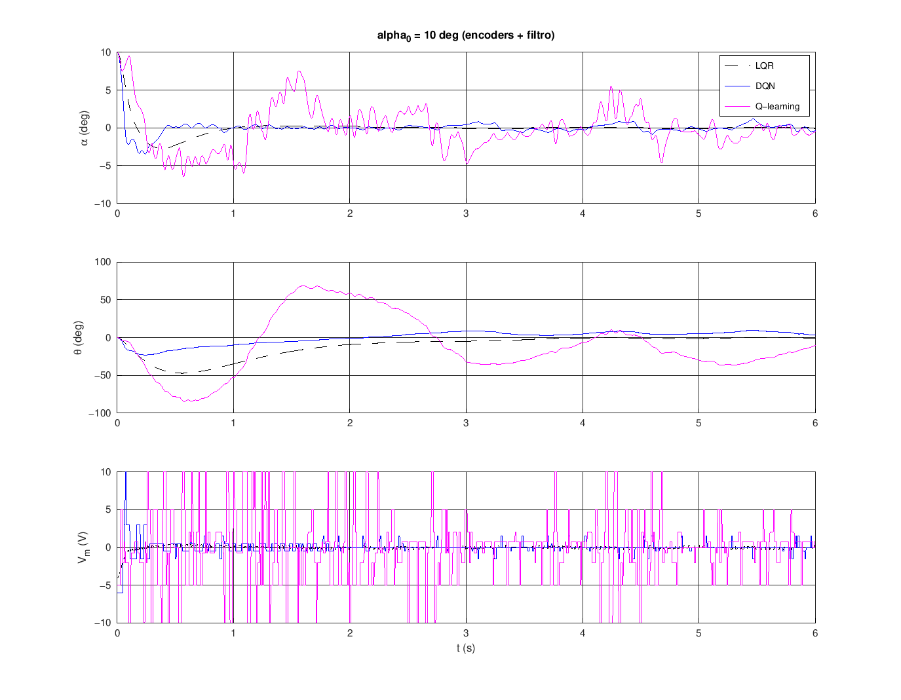

# Control por Aprendizaje por Refuerzo del péndulo invertido – Quanser Qube-Servo 3

**Q-learning (tabular)** y **Deep Q-Learning (DQN)** entrenados en **Python**
con el **modelo no lineal** del Qube-Servo 3. Solo se exporta la red/tabla a
`.mat` y se conecta en **tu Simulink original** (`qs3_lqr_ctrl_simulinkFInal.slx`)
en lugar de la ganancia `u = -K*x`.

```
python/                          ENTRENAMIENTO
  qube_model.py                  modelo no lineal (PyTorch, por lotes), verificado vs tus A, B
  rl_env.py                      entorno RL: planta no lineal + encoders + filtro + ruido
  train_dqn.py                   Deep Q-Learning  -> models/dqn_qube.mat
  train_qlearning.py             Q-learning tabular -> models/qlearning_qube.mat
matlab/
  conectar_al_simulink_original.m   inserta el controlador RL en tu Simulink
  dqn_controller_block.m            código del bloque MATLAB Function (DQN)
  qlearning_controller_block.m      código del bloque MATLAB Function (Q-learning)
  cargar_controlador_rl.m           carga red_dqn / tabla_q / Ts_agente (InitFcn)
  main_validacion_rl.m              validación en el modelo no lineal: RL vs LQR
  qube_params.m, qube_nonlinear_dynamics.m, simular_lazo_cerrado.m,
  politica_rl.m, tasa_exito.m       auxiliares
  ProyectoControlFinal.m            tu script (K, observadores)
simulink/
  qs3_lqr_ctrl_simulinkFInal.slx    tu modelo original (no se modifica)
models/                              controladores ya entrenados + figuras
```

## Resultados (modelo no lineal, parámetros ±15 %, encoders + derivada filtrada + ruido)

| Controlador | Éxito Monte Carlo (MATLAB, N=500) | Comentario |
|---|---|---|
| LQR (tu K) | 100 % | referencia |
| **DQN** | **99.8 %** | α dentro de ±1°, voltajes pequeños, θ vuelve al centro |
| Q-learning tabular | 8.2 % (≈ 84 % sobrevive) | mantiene el péndulo arriba, pero en ciclo límite casi bang-bang |

Éxito = el péndulo no cae y en el último 10 % de la simulación |α| < 3° y |θ| < 15°.
El Q-learning tabular queda limitado por la discretización del estado (4D):
sirve como base didáctica; **el DQN es el que conviene probar en el Qube**.



## 1. Modelo no lineal

`x = [θ, α, θ̇, α̇]` (α = 0 arriba), `u = Vm`. Mismos parámetros y convenciones
que `ProyectoControlFinal.m`:

```
(Jr + mp r² + Jp sin²α) θ̈ − mp l r cosα α̈ + 2 Jp sinα cosα θ̇ α̇ + mp l r sinα α̇² = τ − br θ̇
−mp l r cosα θ̈ + Jp α̈ − Jp sinα cosα θ̇² − mp g l sinα = −bp α̇
τ = km (Vm − km θ̇) / Rm
```

Su linealización en x = 0 coincide con tus A y B (error 1e-10), y Python y
MATLAB dan la misma trayectoria hasta 8 cifras.

## 2. Entrenamiento (Python)

Entorno (`rl_env.py`): RK4 a 2 ms (paso de tu Simulink); el agente decide cada
`Ts_agente = 10 ms` (ZOH). Recompensa `r = 1 − (θ² + 20α² + 0.05θ̇² + 0.05α̇² + 0.002u²)`,
−10 si |α| > 25° o |θ| > 120°. Episodios de 5 s que empiezan con |α| ≤ 15°
(tu switch de balance). Para robustez: parámetros ±10 % por episodio,
encoders de 2048 cuentas/rev, derivada filtrada 50s/(s+50) y ruido.

* **DQN**: red 4-128-128-11 (ReLU), 11 voltajes `±10, ±6, ±3, ±1.5, ±0.5, 0`;
  Double DQN, retornos 8-step, red objetivo con copia dura y targets acotados.
  (Con la actualización suave estándar, los valores Q divergían.)
* **Q-learning**: 7×13×7×11 = 7007 celdas × 9 voltajes; 512 entornos en paralelo;
  usa la simetría del péndulo, (x, u) ≡ (−x, −u).

```bash
cd python
pip install -r requirements.txt
python train_dqn.py           # ~15 min en CPU
python train_qlearning.py     # ~12 min en CPU
```

## 3. Validación en MATLAB (opcional, sin Simulink)

```matlab
cd matlab
main_validacion_rl     % verifica bloque == Python y compara RL vs LQR
```

## 4. Conectar al Simulink original

```matlab
cd matlab
ProyectoControlFinal                     % K, L, beta, m (como siempre)
conectar_al_simulink_original('dqn')     % o 'qlearning'
```

Crea `simulink/qs3_dqn_ctrl.slx` (tu modelo queda intacto):

```
Qube With Pendulum (X) → ZOH (Ts_agente) → Controlador DQN → Rate Transition ─┐
u = -K*x (LQR original) ─────────────────────────────────────────────────────┤
                                     Selector LQR/RL (usar_rl) → Enable Balance Control Switch
```

* El controlador RL toma **X directamente** del Qube. Tu ganancia K recibe
  **−X** (bloque `Sum` = 0 − X); si la red tomara esa señal, el signo
  quedaría invertido y el lazo sería inestable.
* Se conserva tu switch |α| ≤ 15° y el LQR: `usar_rl = 1` → RL, `usar_rl = 0` → LQR
  (se puede cambiar en External Mode).
* El bloque solo usa operaciones matriciales → compatible con QUARC.

> El entrenamiento usa `Vmax = 10 V`. Las velocidades de tu modelo real vienen
> de tus observadores; el agente se entrenó con derivada filtrada + ruido para
> tolerar esa diferencia. Prueba primero con `usar_rl = 0`, y al cambiar a
> `usar_rl = 1` ten la mano cerca del péndulo.
